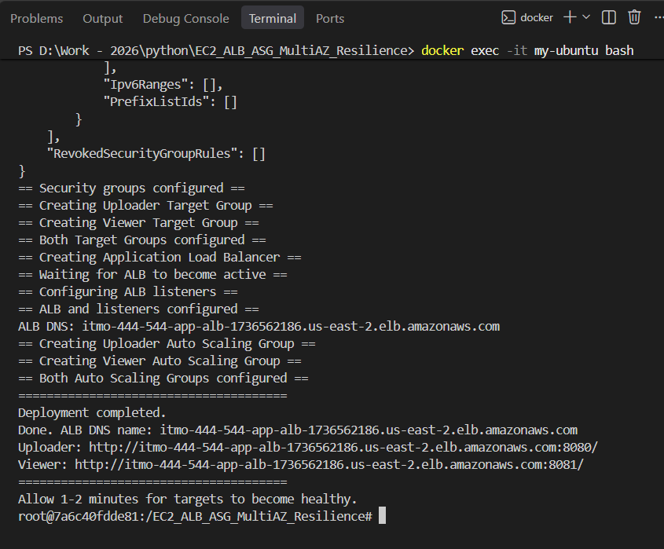
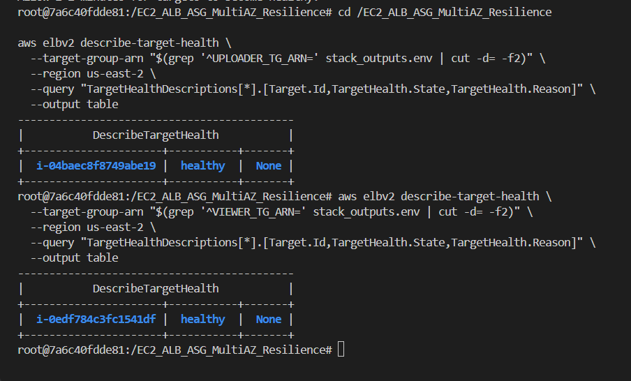
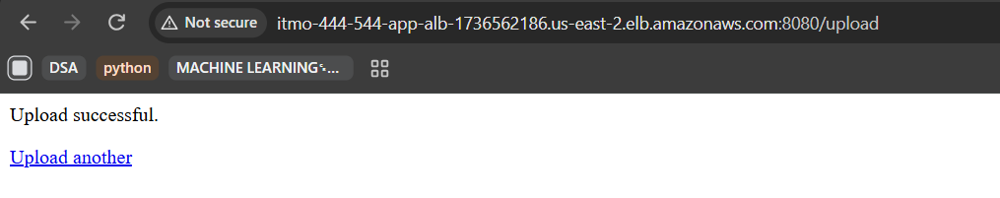
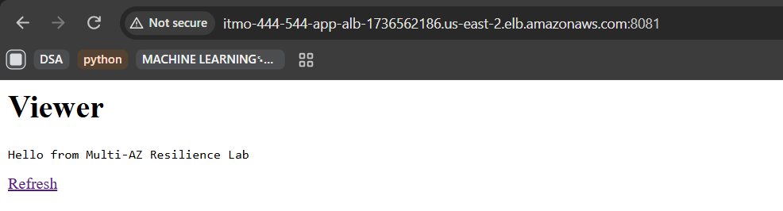
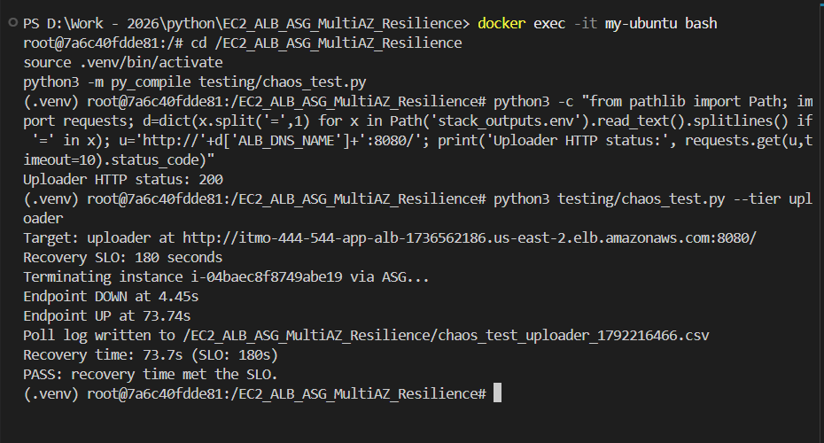
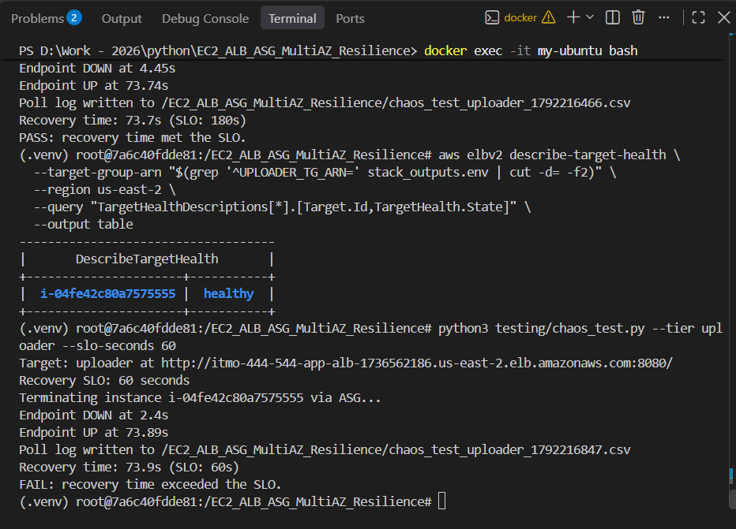
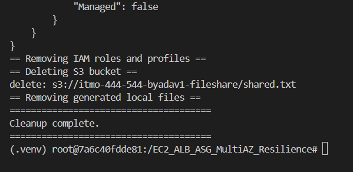

## Screenshots and Evidence

All screenshots documenting the AWS deployment, recovery experiments, and resource cleanup are stored in the [`AWS_ECL_ss`](./AWS_ECL_ss/) folder.

The screenshots provide evidence of:

1. Successful AWS infrastructure deployment.
2. Healthy ALB Target Groups.
3. Working uploader application.
4. Working viewer application.
5. Successful recovery test (PASS — 73.74 seconds against a 180-second SLO).
6. Failed recovery SLO test (FAIL — 73.89 seconds against a 60-second SLO).
7. Successful AWS resource cleanup.

### Recovery Test CSV Files

- [PASS Test — 180-second SLO](./results/chaos_test_uploader_1792216466.csv)
- [FAIL Test — 60-second SLO](./results/chaos_test_uploader_1792216847.csv)

## Screenshots and Evidence

### SS1 — AWS Stack Deployment

### SS2 — Healthy Target Groups

### SS3 — Uploader Application

### SS4 — Viewer Application

### SS5 — Recovery Test PASS (180s SLO)

### SS6 — Recovery Test FAIL (60s SLO)

### SS7 — AWS Resource Cleanup
